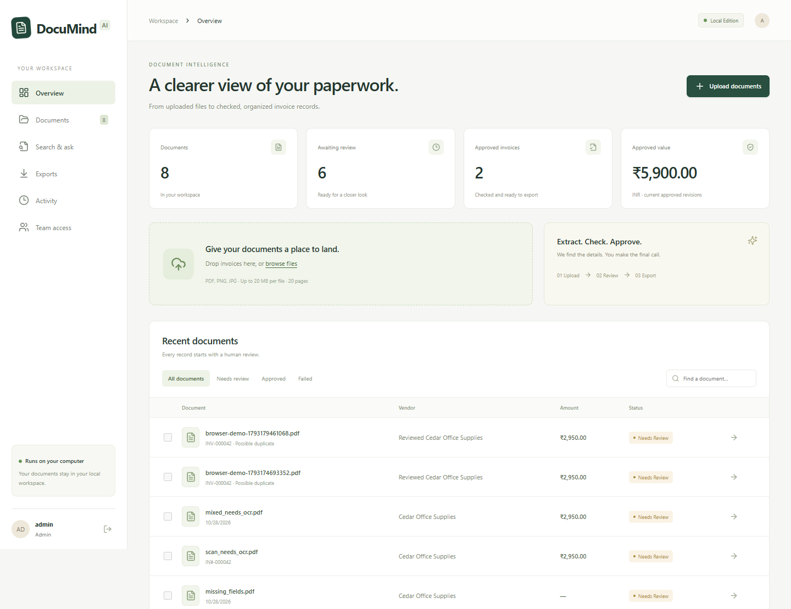

# DocuMind AI

Local document intelligence and invoice review using Python, FastAPI, PostgreSQL, Tesseract OCR, and React. No paid API key is required. This is a learning and portfolio application; validation uses fictional documents and synthetic text datasets.

## Run on Windows

Requirements: Docker Desktop running with Linux containers, Git, and PowerShell. Optional Ollama models: `nomic-embed-text:latest` for semantic search and `qwen3:1.7b` for experimental document Q&A. The app remains usable when models are unavailable.

```powershell
.\scripts\setup.ps1
.\scripts\start.ps1
```

Open **http://localhost:8765**. The first setup creates a unique local administrator password in the ignored `.env` file. Read `DOCUMIND_ADMIN_PASSWORD` there to sign in with username `admin`. Setup never overwrites an existing configuration or password.

Use fictional sample invoices in `data/samples/`. Processing takes place in a separate worker. Uploaded originals remain local in the Docker storage volume. Save a reviewed revision, choose the printed tax mode, resolve blockers, then approve and export. Warnings require a recorded acknowledgement.

See [local setup](docs/local-setup.md), [architecture](docs/architecture.md), [limitations](docs/limitations.md), [data/model notes](docs/data-card.md), and the [original blueprint](docs/PROJECT_BLUEPRINT.md).

Start your review with the [review guide](docs/REVIEW_GUIDE.md) and [verified release results](docs/RELEASE_VERIFICATION.md). The [learning roadmap](docs/learning-roadmap.md) explains the code in dependency order; [portfolio/resume notes](docs/portfolio-and-resume.md) keep presentation tied to the evidence.



A short actual browser acceptance recording is available in `docs/demo/walkthrough.webm`.

## Development

Python 3.12 or 3.13 and Node.js 22+ are supported. For a native Python environment, install the pinned dependencies, then the project without resolving again:

```powershell
py -3.13 -m venv .venv
.\.venv\Scripts\python.exe -m pip install -r requirements.lock
.\.venv\Scripts\python.exe -m pip install --no-deps --no-build-isolation -e .
.\.venv\Scripts\python.exe -m documind_ai doctor
.\.venv\Scripts\python.exe -m documind_ai extract data/samples/digital_basic.pdf --output output/basic.json
```

If Windows' Python launcher points to an unconfigured install manager, use the full path to an installed Python executable instead of `py`.

```powershell
docker compose exec -T app python -m pytest
docker compose exec -T app python -m ruff check backend
docker compose exec -T app python -m documind_ai.manage train
```

Frontend development: run `npm ci` then `npm run dev` inside `frontend/`. Vite proxies API requests to the local backend. Build with `npm run build`.

## What the application does

- Accepts bounded PDF/PNG/JPEG uploads and preserves content-addressed originals.
- Uses native PDF text first, OCR for scanned pages, and evidence-linked header/row candidates.
- Tracks durable jobs, retries, processing runs, immutable review revisions, approvals, and exports.
- Requires current-revision approval before accounting export; editing invalidates approval.
- Supports administrator, reviewer, and uploader roles with session authentication and CSRF protection.
- Provides keyword search and optional local semantic search and cited Q&A.
- Evaluates a lightweight classifier on template-grouped synthetic text data.
- Includes tests, local packaging, backup/restore verification, and learning documentation.

Read the evaluation report for the actual verified scope. Synthetic results do not establish real-invoice accuracy or production reliability. This application does not make payments or file taxes.

## Publishing

The repository contains only fictional samples. Never commit `.env`, private invoices, database dumps, model weights, storage, or backups. Our source is MIT-licensed; upstream libraries and model weights retain their own licenses. See `THIRD_PARTY_NOTICES.md`.
