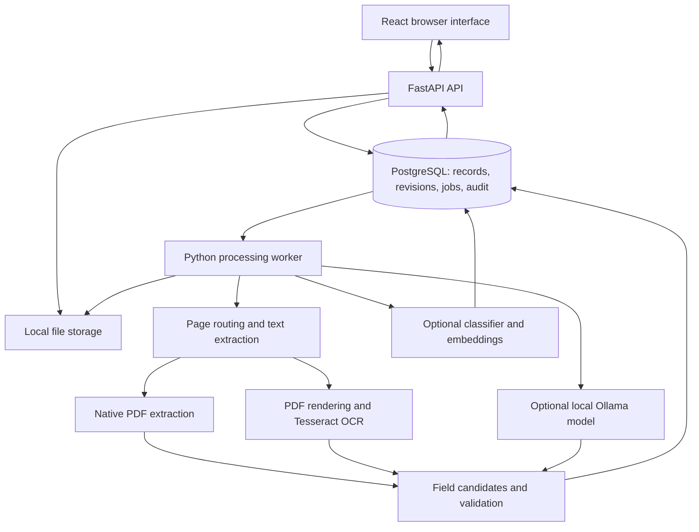

# DocuMind AI — Intelligent Document Processing & Invoice Automation Platform

Original planning blueprint · 28 October 2026. Implementation decisions and verified results are tracked in the architecture and release-verification documents beside this file.

## 1. Project goal and budget

Build a local document-processing application that turns PDFs and scanned invoice images into reviewed, structured records. A user uploads a file, watches processing progress, checks extracted values against the source, corrects mistakes, approves a specific revision, and exports it. Later versions add document classification, semantic search, and optional question answering with a local language model.

The purpose is to learn Python application development, document processing, SQL, machine learning, full-stack development, testing, and deployment while producing an inspectable portfolio project.

The required operating path uses no paid APIs, hosted inference, subscription database, cloud storage, or cloud hosting. Downloads and initial setup require an internet connection; processing should work offline once dependencies, OCR language files, and enabled models are cached. Existing hardware, storage, internet, and electricity are assumed. We will not require new hardware. Optional model features can be disabled if they are too slow.

Zero budget does not imply unlimited compute or a free always-on public application. The release target is a reproducible local application, accompanied by a public source repository, screenshots, benchmark reports, and a recorded demonstration.

## 2. Scope and example workflow

### First supported scope

- English, printed, single-invoice documents in PDF, PNG, and JPEG format.
- Digital PDFs, image-only scans, and mixed PDFs with page-level routing.
- INR invoices initially. Persist a currency code even before adding other currencies.
- Variable header layouts and a documented, limited set of line-item table layouts.
- A local, single-organization application. Multi-user review is added before presenting role-based access as a completed capability.
- Mandatory human approval before an invoice is included in an accounting export.

Receipts and unrelated documents become classification categories later. They can be searched, but they do not automatically become approved invoices. Handwriting, arbitrary languages, bundled invoices, real bank payments, tax filing, and universal accounting-system support are outside the first release.

### Demonstration scenario

1. Upload a synthetic invoice containing a vendor name, invoice number, dates, line items, subtotal, discount, printed tax, and total.
2. The app validates the file, records its hash, and creates a processing job.
3. It extracts native text or performs OCR as appropriate for each page.
4. It proposes structured fields and shows the source evidence for each one.
5. A mismatch between the line-item sum and printed subtotal produces a review issue.
6. A reviewer fixes an OCR error while the original extraction remains available.
7. Approval records the reviewer, time, and exact approved revision.
8. Export produces CSV/JSON and an export history entry.
9. Uploading the same file again produces a duplicate warning without overwriting history.

Approval and export are the automation boundary. Actual payment or posting to a live accounting system is not part of v1.

## 3. Architecture recommendation

Use a modular monolith: one repository with well-separated Python modules, one PostgreSQL database, one API service, one processing worker, and a browser frontend. The API and worker share domain code. They are separate processes so expensive OCR and model inference do not occupy web-request handlers.



The diagram shows the target architecture across phases, not services installed on day one.

### Why these choices

- **FastAPI:** explicit HTTP APIs, typed request/response schemas, and a useful foundation for Python backend learning.
- **PostgreSQL from the persistence phase:** relational records, transactions, reporting, durable job state, and later pgvector in the same database. Avoid building the full application against SQLite and then discovering database differences during release.
- **Separate Python worker:** processing status, retries, timeouts, and recovery are application features. Start with one worker and a small database-backed queue; do not build a general-purpose task framework.
- **React with TypeScript:** a consistent frontend for source previews, editable tables, progress, and search. Learn the JavaScript/TypeScript foundations immediately before this phase. The backend and document pipeline remain Python.
- **Local files:** straightforward storage for originals and derived page images. A storage interface leaves room for object storage later without requiring it now.
- **Direct model integrations:** begin without an agent framework. Plain functions make extraction, retrieval, validation, and failure handling easier to inspect.

We do not need Kubernetes, Kafka, multiple vector databases, microservices, or an external message broker for this workload. Consider a mature broker only if measured concurrency or scheduling needs outgrow the small worker design.

FastAPI's documentation recommends considering external task-processing tools for heavy background computation. The design implication here is to keep OCR and inference out of the request process; it does not require adopting Celery specifically. [FastAPI background-task guidance](https://fastapi.tiangolo.com/tutorial/background-tasks/)

## 4. Free technology stack

| Area | Initial choice | Purpose / timing |
| --- | --- | --- |
| Python | Python 3.12 as a proposed compatibility baseline | Confirm supported dependency versions during setup and lock them |
| Backend | FastAPI, Uvicorn, Pydantic | API, server, validation |
| Database | PostgreSQL, SQLAlchemy, Alembic, psycopg | Persistence, queries, migrations |
| Native PDF extraction | pdfplumber | Text, coordinates, and table inspection |
| PDF rendering | pypdfium2 | Turn scanned pages into images for OCR and preview |
| OCR | Tesseract plus pytesseract | Local recognition and token-level output |
| Image handling | Pillow; OpenCV only when needed | Rotation, contrast, deskew experiments |
| Baseline extraction | Python regex, label matching, positional rules | Explainable field candidates |
| Classification | scikit-learn | TF-IDF and a linear classifier |
| Embeddings | Sentence Transformers, initially all-MiniLM-L6-v2 | Local semantic search |
| Vector storage | pgvector | Keep embeddings beside document metadata |
| Optional generative AI | Ollama with a license-checked small local model | Field suggestions and grounded Q&A |
| Frontend | React, TypeScript, Vite, ordinary CSS | Review, search, dashboard |
| Sample documents | ReportLab, Pillow | Reproducible synthetic invoices and scan variants |
| Backend checks | pytest, HTTPX, Ruff | Tests, API integration, linting |
| Frontend checks | Vitest / Testing Library; Playwright | Components and critical browser workflows |
| Packaging | Virtual environment first; Docker Compose later | Native local run and repeatable container run |
| Version control and CI | Git, GitHub, standard GitHub Actions runners | Source, issues, automated checks |

pdfplumber works best with machine-generated PDFs; it does not replace OCR. Tesseract recognizes printed text in images. pypdfium2 supplies the PDF rendering step. The current upstream licenses are MIT for pdfplumber, Apache 2.0 for Tesseract, and Apache/BSD terms for pypdfium2 with additional dependency notices. Preserve upstream notices in distributed artifacts. [pdfplumber](https://github.com/jsvine/pdfplumber), [Tesseract](https://github.com/tesseract-ocr/tesseract), [pypdfium2](https://pypdfium2-team.github.io/pypdfium2/readme.html)

Do not install every dependency initially. Maintain core and optional ML/LLM dependency groups. Record exact package versions, model revisions, model hashes, licenses, and configuration in the release documentation.

## 5. Hardware and installation approach

RAM, CPU, and GPU were not successfully identified during planning. The following are planning estimates, not a benchmark of this computer:

- An 8 GB machine may run the core native stack with small batches and one worker; avoid running containers and a language model simultaneously until measured.
- Around 16 GB gives more headroom for the browser, development tools, database, OCR, and small embedding model.
- Quantized language models need additional memory for weights, runtime, and context. Model size on disk is not total runtime memory.
- A dedicated GPU is not a requirement for the core project. Optional language-model inference on CPU can be slow.
- Allow roughly 10–20 GB of initial working space; optional models, containers, generated scans, and repeated experiment outputs can grow beyond that.

Before installing a local language model, record available memory and benchmark a small candidate. Do not download multiple large models by default. If no suitable model performs adequately, release the core application with OCR, classification, and retrieval and document that generative features remain optional.

## 6. Document-processing pipeline

### Ingestion

Accept PDF/PNG/JPEG after checking the actual file structure, not just the extension. Suggested initial configurable limits are 20 MB per file, 20 pages, bounded image pixel counts, and one active processing job. These are our starting limits, not upstream library limits.

Assign internal IDs and storage names, calculate a SHA-256 hash, preserve the original, and stage writes before marking an upload ready. Keep database and file state recoverable after failures; periodically reconcile abandoned staging files. A blob can be deduplicated, but each upload still has its own record and duplicate relationship.

Reject unsupported, corrupt, or encrypted documents with an actionable reason. Do not guess that an unreadable file is a valid empty invoice.

### Page inspection and OCR

Inspect every page. Use native text where it is usable; render and OCR image-only or suspicious pages. Text length alone is not a sufficient quality test because an existing OCR text layer can be wrong. Keep the routing decision and quality diagnostics.

Store page numbers, token text, bounding boxes, extraction method, and coordinate transformations. OCR boxes measured in pixels must map back to the preview after resizing, rotation, or deskewing. Cache derived outputs by file hash plus extraction configuration/version.

Start with English Tesseract data. Compare grayscale, contrast, and deskew variants on fixtures instead of applying every preprocessing step indiscriminately. A poorly chosen preprocessing operation can erase punctuation or digits.

### Structured extraction

Use labels, nearby text, patterns, and position to propose:

- Vendor and customer names.
- Invoice number, invoice date, due date, and currency.
- Subtotal, discount, tax, shipping if printed, total, and amount due if printed.
- Line-item descriptions, quantity, unit price, printed line amount, and optional tax information.

Store raw text separately from normalized values. Keep invoice numbers as strings; preserve leading zeros. Parse dates explicitly and flag ambiguous formats. Use Python Decimal and PostgreSQL NUMERIC for amounts; send decimal strings across the API. Missing or unreadable values remain null, never invented zeroes.

For every proposed field retain: raw value, normalized value, extraction method, page, supporting tokens/span, optional box, and validation issues. Native text evidence can use a source span when a box is unavailable. An inferred or calculated value must be labelled as such and kept separate from a printed value.

Line-item extraction will be the hardest early feature. Begin with documented table layouts and show unresolved rows to a reviewer. Do not silently omit a row or promise general table understanding.

### Validation and review

Check required fields, date parsing, arithmetic consistency, possible duplicates, and unusual amounts. Compare line-item totals and printed totals only when their components and rounding rules are known. Make tax-inclusive/exclusive assumptions explicit; do not interpret this as tax-compliance software.

Exact duplicates use hashes. Possible business duplicates use normalized vendor, invoice number, date, currency, and amount. Missing identifiers produce a warning or incomplete match, not a definitive duplicate verdict. Outlier detection produces an unusual-value flag, not a fraud diagnosis.

OCR confidence, classifier scores, and rule-based review scores are different quantities. Display them with their method names; do not convert them into a universal accuracy percentage. Calibrate any automatic review-routing threshold using validation data. V1 approval remains manual.

Edits create revisions and rerun validation. Approval references one revision. Editing an approved invoice invalidates that approval until the new revision is checked. Use optimistic concurrency so two reviewers cannot silently overwrite each other.

### Export

Export only an approved, current revision. A blocking issue requires correction or an explicit, recorded reviewer override with a reason. Produce CSV and JSON first; an XLSX adapter can follow. Neutralize spreadsheet formula injection in user-controlled text. Record exported revision IDs and a content hash so a repeated request does not accidentally create inconsistent output.

## 7. Processing state and worker reliability

Keep processing state separate from review and export state:

```text
Processing: queued -> processing -> succeeded | failed
Review: pending -> needs_review -> approved | rejected
Export: one or more records referring to approved revisions
```

A stage field can report inspection, extraction, parsing, or validation. Do not calculate a fake percentage when the workload is unknown.

Use a PostgreSQL jobs table and atomic job claiming. Start with one worker. Keep claim transactions short; do not hold row locks during OCR. Store a lease/heartbeat, attempts, configuration, and error category. After an expired lease, work can be retried with bounded attempts and backoff.

Design for at-least-once execution: repeated work must not duplicate invoice rows, revisions, or export effects. Publish a completed extraction run transactionally. Keep failed runs for diagnosis without replacing a reviewed invoice. Reprocessing creates a new extraction result; it must never erase human corrections.

Use processing subprocess timeouts and bounded resource usage for external parsers/OCR. A file failure must not kill the worker loop or leave a job permanently processing.

## 8. ML, search, and optional language models

### Document classification

Begin with a keyword/rule baseline. Add a scikit-learn pipeline with TF-IDF and Logistic Regression for invoice, receipt, and other. Use validation data to choose a low-confidence abstention path labelled unknown. Evaluate genuinely unfamiliar documents separately; an other class does not guarantee out-of-distribution detection.

Compare learned classification against the baseline by category. If the model does not help, keep the simpler method and publish the experiment rather than adding complexity for appearance.

### Search and retrieval

Build exact metadata filters and keyword search first. Add page-aware chunks and local embeddings later. A candidate is all-MiniLM-L6-v2, whose model card specifies 384-dimensional embeddings and default truncation beyond 256 word pieces. Use its tokenizer to keep chunks within the actual limit. This English-oriented starting choice is not a multilingual guarantee. [MiniLM model card](https://huggingface.co/sentence-transformers/all-MiniLM-L6-v2)

Store chunks, page references, model revision, embedding dimension, and content hash. A model change requires a separate index version or re-embedding. Initially use exact vector search; add approximate indexing only if measurements justify it. pgvector supports both approaches. [pgvector](https://github.com/pgvector/pgvector)

Invoice-number and date lookups should use exact fields. A request such as “approved invoices over INR 10,000” belongs to validated SQL filters. Semantic retrieval is for related language, such as “annual software renewal”; it is not a reliable way to calculate totals over every invoice.

### Optional local LLM

Use Ollama only with a locally downloaded, license-checked model. A small Qwen3 model is a candidate for benchmarking, not a claim about the latest or best model. The upstream Qwen3-1.7B card lists Apache 2.0; check the precise distributed artifact and quantization when selecting it. [Qwen3-1.7B model card](https://huggingface.co/Qwen/Qwen3-1.7B)

Use JSON-schema output and validate it with Pydantic. Schema compliance only checks shape; it does not prove that values are supported by the invoice. Require source evidence, preserve conflicting candidates, allow nulls, and place ungrounded results in review. Bound response length, context, timeout, and retries. [Ollama structured outputs](https://docs.ollama.com/capabilities/structured-outputs)

For Q&A, retrieve authorized chunks, answer only from those chunks, cite the document and page, and abstain if evidence is absent. Never allow invoice text to issue tool calls, execute commands, approve records, or alter system instructions. Numeric answers and citations still need verification; evaluate unsupported-answer behavior explicitly.

Keep all core workflows functional when Ollama is unavailable. Set Ollama's local-only configuration and test the offline path; its upstream documentation describes disabling cloud features using OLLAMA_NO_CLOUD=1. [Ollama FAQ](https://github.com/ollama/ollama/blob/main/docs/faq.mdx)

## 9. Database design

Use UUID keys where useful, UTC event timestamps, foreign keys, uniqueness constraints, and migration files. Normalize business records; use JSONB for raw provider output, versioned configuration, and diagnostics rather than hiding the entire application in JSON.

| Table | Main contents |
| --- | --- |
| users | Local account, password hash, active state, role; introduced with authentication |
| blobs | Hash, internal storage key, bytes, detected media type |
| documents | Upload metadata, blob reference, status, type, duplicate relationship, uploader |
| pages | Document, page number, dimensions, extraction method, text, token coordinates |
| jobs | Kind, document/run reference, state, attempts, lease, heartbeat, timestamps, error |
| extraction_runs | Pipeline version, source hash, model/config revisions, timings, raw result |
| field_candidates | Run, field path, raw/normalized values, source evidence, method |
| invoices | Document, current revision, lifecycle status, row version |
| invoice_revisions | Immutable normalized header snapshot, author, reason, time |
| invoice_items | Revision-specific line items and source references |
| validation_issues | Run/revision, rule, severity, evidence, resolution or override reason |
| approvals | Revision, reviewer, decision, reason, timestamp |
| export_batches / export_items | Format, content hash, exported approved revisions, timestamp |
| audit_events | Actor, action, entity, revision reference, safe change metadata |
| document_chunks | Document/page references, chunk text, embedding, model/index version |

Add tables as phases need them. Revision-specific items, approvals, and exports prevent later edits from changing the meaning of historical records. Audit events are append-only through the application, but a local database administrator can still modify the database; do not call the audit trail tamper-proof.

## 10. API and frontend contract

Proposed endpoints, refined during implementation:

```text
POST   /api/v1/documents                 upload -> document ID and job ID (202)
GET    /api/v1/documents                 list, filters, pagination
GET    /api/v1/documents/{id}            metadata and processing/review status
GET    /api/v1/documents/{id}/pages/{n}   authorized page preview
POST   /api/v1/documents/{id}/reprocess  new versioned extraction job
GET    /api/v1/jobs/{id}                 progress stage and safe failure reason
GET    /api/v1/invoices/{id}             current revision and source evidence
PATCH  /api/v1/invoices/{id}             version-checked edit -> new revision
POST   /api/v1/invoices/{id}/approvals   decision about a specific revision
POST   /api/v1/exports                   approved revision selection
GET    /api/v1/search                    metadata/keyword/semantic search
POST   /api/v1/questions                optional grounded Q&A
GET    /api/v1/health                    process health
GET    /api/v1/ready                     required dependency readiness
```

Do not expose server filesystem paths. Validate IDs, file access, permissions, pagination limits, and version conflicts on the backend. Add session and user-management endpoints only when authentication is implemented.

Frontend screens:

1. Inbox: uploads, processing states, duplicates, and failures.
2. Review workspace: page preview beside editable fields and line items, source highlights, issues, revision history, approval controls.
3. Approved invoices: currency-aware filters and explicit export selection.
4. Search: exact fields, keywords, semantic results with pages; optional question panel.
5. Operations: job failures, retries, stage timings, model availability.
6. Dashboard: record counts and processing/review statistics. Distinguish extracted, approved, and exported amounts. Never combine currencies into one total without an explicit conversion method.

Use polling first. Add streaming progress only if polling is insufficient. Include keyboard navigation, readable validation errors, and non-color indicators for status.

## 11. Folder structure

```text
documind-ai/
  backend/
    app/
      api/                 routes and dependencies
      core/                configuration, security, logging
      db/                  models and persistence
      schemas/             typed API/domain contracts
      services/            ingestion, review, exports
      pipelines/           page processing and orchestration
      extractors/          native PDF, OCR, field/table rules
      ml/                  classifier, embeddings, optional LLM adapter
      workers/             job claiming and processing entry point
    migrations/
    tests/
    pyproject.toml
  frontend/
    src/
      api/
      components/
      pages/
      types/
    tests/
    package.json
  data/
    samples/               small, publishable synthetic fixtures
    manifests/             labels, splits, hashes, provenance
  storage/                 local originals and generated artifacts; ignored
  models/                  downloaded weights; ignored
  evaluation/
    configs/
    reports/
  scripts/                 seed, benchmark, backup, restore
  docs/
    PROJECT_BLUEPRINT.md
    architecture.md
    local-setup.md
    data-card.md
    model-card.md
    limitations.md
    decisions/
  .github/workflows/
  .env.example
  .gitignore
  compose.yaml
  README.md
  LICENSE
  THIRD_PARTY_NOTICES.md
```

This is the intended structure. Create folders when they acquire real contents; avoid empty abstractions. The current workspace's longer name can remain. Use simple internal package, container, and repository names such as documind_ai and documind-ai, and quote Windows paths that contain spaces or ampersands.

## 12. Learning roadmap and implementation phases

Learn each topic while building the feature that needs it. At every phase, explain the flow in your own words, make a small change yourself, reproduce a failure, and verify a fresh run. Keep a short learning journal in docs.

### Phase 0 — Setup, contracts, and scope

Learn terminal basics, Git commits, virtual environments, dependency management, environment variables, Python modules, exceptions, type hints, and pytest basics.

Record hardware, select compatible versions, set up the repository and core dependency lock, define the invoice schema, create a few synthetic fixtures, and document supported input. Separate training/development fixtures from a reserved test set from the beginning.

**Exit:** a fresh environment can run a basic check and validate a hand-authored invoice JSON. No paid key is required.

### Phase 1 — Native PDF extraction CLI

Learn files, pathlib, lists/dicts, functions, dataclasses or Pydantic models, JSON, and coordinates.

Build a command-line path from a digital PDF to page text, token evidence, basic invoice candidates, and JSON output. Initially process synchronously so the pipeline is easy to debug.

**Exit:** supported digital samples produce inspectable output; missing values remain null; a scanned PDF is identified as needing OCR.

### Phase 2 — Scanned and mixed documents

Learn pixels versus PDF coordinates, DPI, image preprocessing, OCR output, subprocesses, and timeouts.

Add rendering, page-level routing, OCR token boxes, previews, cache keys, and failure handling.

**Exit:** digital, scanned, rotated, and mixed fixtures use the appropriate paths; failed pages remain visible; source overlays map correctly.

### Phase 3 — Invoice extraction and validation

Learn regex, Decimal, date parsing, nested schemas, rule design, and table limitations.

Extract header fields and supported line-item layouts. Add arithmetic issues, ambiguous-date warnings, duplicate candidates, and source evidence.

**Exit:** printed totals and calculated totals remain distinct; validation finds intentionally seeded mistakes; unsupported layouts require review.

### Phase 4 — Database, API, and durable jobs

Learn HTTP/JSON, SQL, relational design, SQLAlchemy, migrations, transactions, process boundaries, retries, and idempotency.

Persist files and records, implement versioned endpoints, move processing into the worker, and add health/readiness checks and structured logs.

**Exit:** upload returns promptly with an ID, records survive restart, job recovery works after killing the worker, and retries do not duplicate business records.

### Phase 5 — Browser review workflow

Learn HTML/CSS, JavaScript fundamentals, TypeScript types, React components/state, forms, API calls, and browser tests.

Build inbox, preview, source-linked editing, line items, revision history, approval, and CSV/JSON export. MVP uses one explicitly identified local reviewer; do not imply independent reviewer separation yet.

**Exit:** upload -> review -> correction -> approval -> export works end to end. Editing after approval blocks export until the new revision is approved.

**This is the first complete product milestone (v0.1).** It is valuable without generative AI.

### Phase 6 — ML classification and search

Learn labels, TF-IDF, train/validation/test separation, macro-F1, confusion matrices, embeddings, cosine similarity, retrieval evaluation, and pgvector.

Build and compare the rule and classifier baselines. Add exact search, then semantic retrieval with page-linked results.

**Exit:** a versioned evaluation report separates held-out templates from familiar layouts and reports retrieval recall alongside classification results. Unknown/unsupported inputs have an explicit path.

### Phase 7 — Optional local generative AI

Learn model inference, quantization, context windows, structured outputs, retrieval-augmented generation, evidence checking, and prompt injection.

Benchmark one candidate model, add optional field suggestions and grounded Q&A, enforce limits and schema validation, and test absent evidence and model outages.

**Exit:** local model results are compared with the baseline; unsupported answers are measured; core operation succeeds with the model disabled. A negative benchmark can justify leaving this feature experimental.

### Phase 8 — Access control and operational hardening

Learn password hashing, sessions, authorization, optimistic concurrency, backups, restoration, resource limits, and safe file serving.

Add local user accounts and uploader/reviewer/admin roles. Use a maintained password-hashing library with Argon2, secure cookie/session handling, appropriate CSRF/origin controls, and server-side authorization on every file and action. Configure HTTPS before any remote use. Define whether reviewers can approve their own uploads and test that policy. Add deterministic mock accounting export/import adapters only if useful.

**Exit:** permission bypass and stale-edit tests pass; a restored backup can open originals and their records; restart and malformed-input tests pass. A database backup without the associated files is not a complete backup.

### Phase 9 — Packaging, independent setup, and release

Learn Docker/Compose, CI, dependency pinning, release notes, reproducible benchmarks, and technical presentation.

Package a native run and optional Compose run, publish safe fixtures and reports, record the demo, verify a clean setup, and prepare the repository and portfolio materials.

**Exit:** another person can follow the instructions using free tools, process the sample pack, reproduce documented checks, and understand limitations. Tag a local release candidate; do not equate this with production validation.

### Effort estimate

For someone learning while building: approximately 100–170 focused hours for the core workflow and 60–120 additional hours for evaluated ML, optional LLM experiments, hardening, and release. Total planning range: 160–290 hours, with substantial variation from prior knowledge and difficult table layouts. At roughly 10 hours/week, this is about 4–7 months. Treat phase exit criteria as the guide, not calendar pressure. Optional LLM work can be omitted without blocking a complete core release.

## 13. Dataset and evaluation plan

Start with 10–20 development documents. Before model evaluation, aim for roughly 300 independently generated source documents across multiple template families and invoice/receipt/other categories. Include varied dates, currencies reserved for later support, descriptions, numeric values, and missing fields without using real identities or account numbers.

Use deterministic generation and save ground-truth JSON alongside each source. Derive scans with rotation, blur, noise, and contrast changes. A scan and its clean original are the same underlying sample family; do not count them as independent evidence.

Aim for a 60/20/20 train/validation/test split grouped by vendor/template family. Reserve unseen families for the test set, with category coverage where feasible. All variants stay in the same split. Fit preprocessing and classifiers on training data only, tune prompts/rules/thresholds on development or validation data, and use the locked test set for final assessment. Report sample counts and class distributions rather than only percentages.

Synthetic data makes labels cheap and reproducible but can make the task easier than real documents. If appropriately licensed public samples are later added, evaluate them separately, document permission and provenance, and do not assume public accessibility grants redistribution rights. No unverified public dataset is required by this blueprint.

### Metrics

| Area | Measure |
| --- | --- |
| OCR | Character/word error rate against labelled text, by scan condition |
| Classification | Macro-F1, per-class precision/recall, confusion matrix, abstention coverage |
| Header fields | Normalized exact-match rate by field, missing-field recall, false extractions |
| Invoice extraction | All-required-fields-correct rate on supported inputs |
| Line items | Row matching plus field/cell precision and recall; omitted-row rate |
| Routing | Review rate, errors among records labelled ready, override frequency |
| Retrieval | Recall@k or MRR on labelled query-document/page pairs; exact-filter tests |
| Optional Q&A | Evidence support, citation correctness, answerability, correct abstention |
| Runtime | Stage latency and p50/p95 over a stated sample; peak memory and failure rate |
| Workflow | Revision/approval correctness, duplicate effects, recovery outcomes |

Publish denominators, normalization rules, tolerance choices, hardware, versions, model revisions, supported scope, and known failures. A value extracted only after a human correction is not automatic extraction accuracy. A model declining to answer is not correct extraction, even if its answers are precise when present.

Compare native/rule baseline, OCR/rule pipeline, learned classification, and optional LLM-assisted extraction on the same held-out set. No percentage improvement or accuracy claim exists until measured.

## 14. Test strategy

Tests protect behavior that can fail or lose data; a target test count is not a quality goal.

- **Unit:** amount/date normalization, null handling, required fields, label matching, arithmetic, duplicate logic, state transitions.
- **Property/invariant:** edits never mutate old revisions; approved exports cannot silently reference an unapproved edit; money is not processed with binary floats.
- **Integration:** actual PostgreSQL migrations/constraints, upload and storage, extraction metadata, worker claims, retry idempotency, export history. Do not substitute SQLite for PostgreSQL-specific behavior.
- **Document fixtures:** clean, scanned, mixed, skewed, low-quality, multi-page, ambiguous-date, missing-total, malformed, encrypted, oversized, and unsupported layouts.
- **Concurrency/recovery:** worker death mid-stage, stale lease, repeat submission, double approval, stale form save, storage/DB interruption, model timeout, restart after partial output.
- **Security:** path traversal, mismatched file types, unauthenticated download, unauthorized actions, CSRF where applicable, spreadsheet formula injection, excessive page/image dimensions, and instruction-like text in a document.
- **Browser:** upload -> issue -> correction -> approval -> export; approval invalidation after edit; clear error and retry behavior; review usability with keyboard.
- **Model evaluation:** separate benchmark harness and frozen datasets. Normal unit tests should not need a downloaded LLM. Test real local inference separately; mocks verify contracts, not model quality.
- **Offline smoke test:** after setup and caching, disconnect external network access and run upload, OCR, review, search, and the enabled local model path.

CI runs linting, backend checks, PostgreSQL integration tests, frontend checks/build, and a small browser smoke test. Keep full model benchmarks and large OCR corpora as explicit local/release jobs. GitHub currently makes standard hosted runners free for public repositories, while larger runners are billed and storage has limits; use short retention and avoid storing model weights in Actions artifacts. [GitHub Actions billing](https://docs.github.com/en/billing/concepts/product-billing/github-actions)

## 15. Local deployment and recovery

### Development

Start natively with a Python virtual environment, local PostgreSQL, Tesseract, the API process, one worker, and the frontend development server. Add optional embedding/model dependencies only when their phases begin. Keep upload storage, temporary files, database credentials, and model paths in environment configuration.

### Packaged local release

Serve the built frontend and API through one local origin. Compose can run the app, worker, and PostgreSQL; a host Ollama installation can remain optional behind a configurable endpoint. Document container-to-host connectivity if using that arrangement. Avoid assuming GPU passthrough is available.

Bind published ports to loopback, persist both the database and file storage, run migrations deliberately, and add readiness checks. Choose explicit compatible image tags and preserve a dependency lock. Do not expose the database or model server publicly.

Docker Desktop currently permits free personal/educational use; its Windows container workflow normally needs WSL 2 and virtualization. Containerization remains optional, so it does not block the native path. Recheck compatibility and terms at installation. [Docker Windows documentation](https://docs.docker.com/desktop/setup/install/windows-install/)

Back up database records and original files consistently, plus necessary configuration and model-version metadata. Derived previews and embeddings may be rebuildable, but document the procedure. Restore into a fresh local directory/database and verify sample documents, approvals, and exports. File deletion must consider deduplicated references; do not delete a shared blob while another document still refers to it.

Keep private documents out of Git, release archives, screenshots, benchmark artifacts, and application logs. Render previews as images or controlled files, escape extracted text in HTML, and log IDs/timings/errors rather than document contents. These are concrete requirements for a document-handling app, not evidence of a completed security certification.

## 16. GitHub, portfolio, and resume presentation

### Repository

Repository: [Dilep01/documind-ai](https://github.com/Dilep01/documind-ai). The following describes the original publication checklist.

The README should explain the problem and supported scope, show a short demo, include the architecture diagram, list free dependencies and setup steps, run a sample invoice, describe test/benchmark commands, report measured results, and link known limitations and licensing notices.

Commit source, small synthetic fixtures, ground-truth labels, dataset manifests, migrations, lockfiles, benchmark summaries, and reproducible setup scripts. Exclude real invoices, secrets, database dumps, model weights, local caches, and bulk generated images. Add a license for our code and preserve separate third-party/model notices.

Use small commits and milestone issues. Suitable release progression is a CLI milestone, core review application, evaluated classification/search, optional local AI, and a hardened local release candidate. Release names should reflect completed features, not planned ones.

### Demonstration

Record a 3–5 minute walkthrough: upload one digital invoice and one scan; show field evidence; correct a deliberate error; approve and export; show a duplicate warning; show keyword/semantic search when implemented; end with benchmark conditions and a known failure. Show model-disabled operation if that is part of the release claim.

### Portfolio

After implementation, describe it as a local document-processing application with OCR, structured extraction, source-linked review, validation, and versioned exports. Add ML/search only when completed. Explain the measured data scope and link the repository, video, and evaluation report. A static sample-data preview can accompany it, clearly labelled as a demonstration; it is separate from a hosted backend.

### Resume

Do not add this as completed work while only a blueprint exists. After building, use evidence-backed bullets such as: built a local invoice-processing application using Python, FastAPI, PostgreSQL, and OCR; implemented review and export with revision history; evaluated extraction on held-out synthetic templates. Add exact metrics only after measurement and retain the synthetic/local qualification. Do not claim business savings, production deployment, fraud prevention, financial compliance, or real customer usage without evidence.

### Interview preparation

Be able to explain why native extraction precedes OCR; why fields need evidence; why JSON schema does not guarantee truth; how template leakage affects evaluation; why Decimal is used; how jobs recover; how approvals survive revisions; what local AI adds compared with rules; and which unsupported documents fail. Keep an example of a failed approach and the evidence that led to changing it.

## 17. Recommended starting point

Start implementation with Phase 0 and Phase 1: confirm the environment, define the invoice contract, create a few synthetic invoices, and produce source-linked JSON from a digital PDF. Keep the first end-to-end pipeline small enough to understand. Add the database, UI, ML, and optional model as the relevant phase needs them.

The complete core release is a local application that processes supported invoices, exposes errors and evidence, requires deliberate review, exports a reproducible approved revision, recovers from restart, and includes honest evaluation and setup documentation. Advanced features extend that release; they do not replace these foundations.
